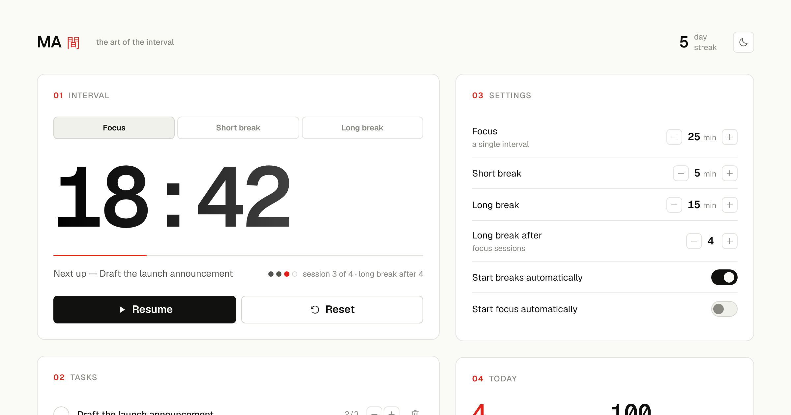

# MA · 間

A Pomodoro focus timer built around the Japanese concept of **間 (ma)** — the
meaningful interval, the pause that gives shape to the work around it.

**Live:** https://benafcode.github.io/maticha_timer/



## What it does

- **Three modes** — Focus, Short Break, Long Break, each with its own duration
- **Task list tied to the cycle** — pick the task you're working on and each
  completed focus session is credited to it; a task that reaches its estimate
  completes itself and focus moves to the next one
- **Auto-advance** between focus and breaks, independently toggleable
- **Session tracking** — a dot per session toward the long break
- **Today's stats** — sessions, minutes focused, and a seven-day bar chart
- **Day streak** across consecutive days of use
- **Stoic quotes** from Epictetus, Seneca and Marcus Aurelius, rotating
  every three minutes
- **Everything persists** in `localStorage`, including the remaining time, so
  a refresh keeps your place

## Design

The art direction is **Editorial greeting**, dealt from taste-skill's app screen
library (seed `186861371`, kind `workspace`) and recorded in `.taste-skill/`. It is
a personal home that opens with a typeset greeting naming today's one fact, taken
from the data rather than written in advance:

> Evening. Four intervals done.
> Monday, November 2 · 100 minutes of focus so far

Below it, four count tiles and then panels on a real 12 column grid: 1100px of
content, 77px tracks, 16px gutters (`1100 − 11×16 = 924`, `924 ÷ 12 = 77`). Spans
change by row but share column lines — 3/3/3/3, then 9/3, then 6/6 — so every
internal edge meets one above it. Figures sit at regular weight on tonal panels,
and the one white inner card the style allows is spent on the chart.

The rules underneath are Part B of `landing-page-design`, and where the two
disagree the rules win. Each substitution is recorded at the point of use in
`styles.css`:

| The sheet | The rules | Shipped |
|---|---|---|
| greeting 48/700 in a serif | one face, cap at semibold | 48/600 in Geist |
| figures at 32px | Tailwind scale only | 30px, the step below |
| card radius 22px | Tailwind radius values | 24px |
| panel padding 20px | the spacing tokens | 24px |

The red is gone. It was not a taste call: this style's research bans red as an
accent outright, having found that red marking good news reads as an alarm. The
accent is now a deep teal, and red survives only on the failing fact.

Both themes ship. The page follows the operating system until you press the
switch, after which your choice is remembered. Dark grounds are drawn only from
the six the rules permit.

**One stated deviation.** The sheet asks for panels in reading order on small
screens. That order puts the greeting and four tiles above the countdown, which
leaves the primary action below the fold on a tiled window or a short phone, and
B10 requires it on the first screen. The timer therefore rises above the tiles
while the window cannot hold both, and reading order returns as soon as there is
room.

### Verifying it

The system is enforced by test rather than by discipline. Two Playwright suites
cover it. One walks every rendered element and fails on a font size outside the
scale, a padding or margin outside the spacing tokens, an off scale radius, a
partial card border, a banned typeface, an animated `width` or `height`, a browser
default easing curve, a column track that is not 77px, or an accent that reads as
red. The other drives the timer, the task list and persistence. The layout is
audited across fourteen viewports for horizontal overflow and for the primary
action staying above the fold.

## Running it

There is no build step. It's three files of vanilla HTML, CSS and JavaScript.

```bash
git clone https://github.com/BenafCode/maticha_timer.git
cd maticha_timer
npx http-server -p 8000      # or: python3 -m http.server 8000
```

Then open <http://localhost:8000>.

Opening `index.html` directly over `file://` works too, though serving it is
closer to how it runs in production.

## Deployment

Every push to `main` is published to GitHub Pages by
[`.github/workflows/deploy.yml`](.github/workflows/deploy.yml), which uploads
the repository root as a Pages artifact. Authentication uses the workflow's
OIDC token, so there are no secrets to configure. Pages must be set to deploy
from **GitHub Actions** (Settings → Pages → Source).

## Layout

```
index.html    markup and structure
styles.css    design tokens, grid and components
script.js     timer engine, tasks, stats, persistence
```

State lives in a single `state` object serialised to `localStorage` under the
key `ma_timer_v1`, and `render()` reflects it into the DOM.

## Credits

Typefaces: [Geist and Geist Mono](https://vercel.com/font) by Vercel.

Visual system: the `landing-page-design` skill from
[elayadesign/ai-design-skills](https://github.com/elayadesign/ai-design-skills),
MIT licensed, vendored in [`.claude/skills`](.claude/skills).
