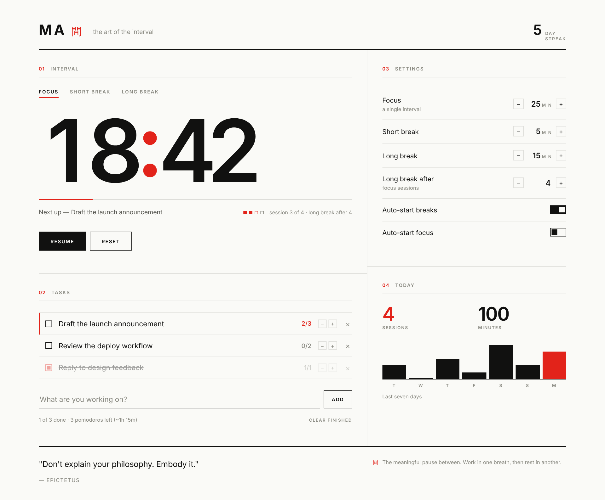

# MA · 間

A Pomodoro focus timer built around the Japanese concept of **間 (ma)** — the
meaningful interval, the pause that gives shape to the work around it.

**Live:** https://benafcode.github.io/maticha_timer/



## What it does

- **Three modes** — Focus, Short Break, Long Break, each with its own duration
- **Task list tied to the cycle** — pick the task you're working on and each
  completed focus session is credited to it; a task that reaches its estimate
  completes itself and focus moves to the next one
- **Auto-advance** between focus and breaks, independently toggleable
- **Session tracking** — a dot per session toward the long break
- **Today's stats** — sessions, minutes focused, and a seven-day bar chart
- **Day streak** across consecutive days of use
- **Stoic quotes** from Epictetus, Seneca and Marcus Aurelius, rotating
  every three minutes
- **Everything persists** in `localStorage`, including the remaining time, so
  a refresh keeps your place

## Design

Swiss typographic discipline applied to a Japanese idea: a strict grid,
hairline rules, a single grotesque at a few decisive sizes, and a palette of
ink, paper and one signal red. No ornament, no shadows, no rounded corners —
structure carries the design, and the empty space is the point.

## Running it

There is no build step. It's three files of vanilla HTML, CSS and JavaScript.

```bash
git clone https://github.com/BenafCode/maticha_timer.git
cd maticha_timer
npx http-server -p 8000      # or: python3 -m http.server 8000
```

Then open <http://localhost:8000>.

Opening `index.html` directly over `file://` works too, though serving it is
closer to how it runs in production.

## Deployment

Every push to `main` is published to GitHub Pages by
[`.github/workflows/deploy.yml`](.github/workflows/deploy.yml), which uploads
the repository root as a Pages artifact. Authentication uses the workflow's
OIDC token, so there are no secrets to configure. Pages must be set to deploy
from **GitHub Actions** (Settings → Pages → Source).

## Layout

```
index.html    markup and structure
styles.css    design tokens, grid and components
script.js     timer engine, tasks, stats, persistence
```

State lives in a single `state` object serialised to `localStorage` under the
key `ma_timer_v1`, and `render()` reflects it into the DOM.

## Credits

Typeface: [Inter](https://rsms.me/inter/) by Rasmus Andersson.
